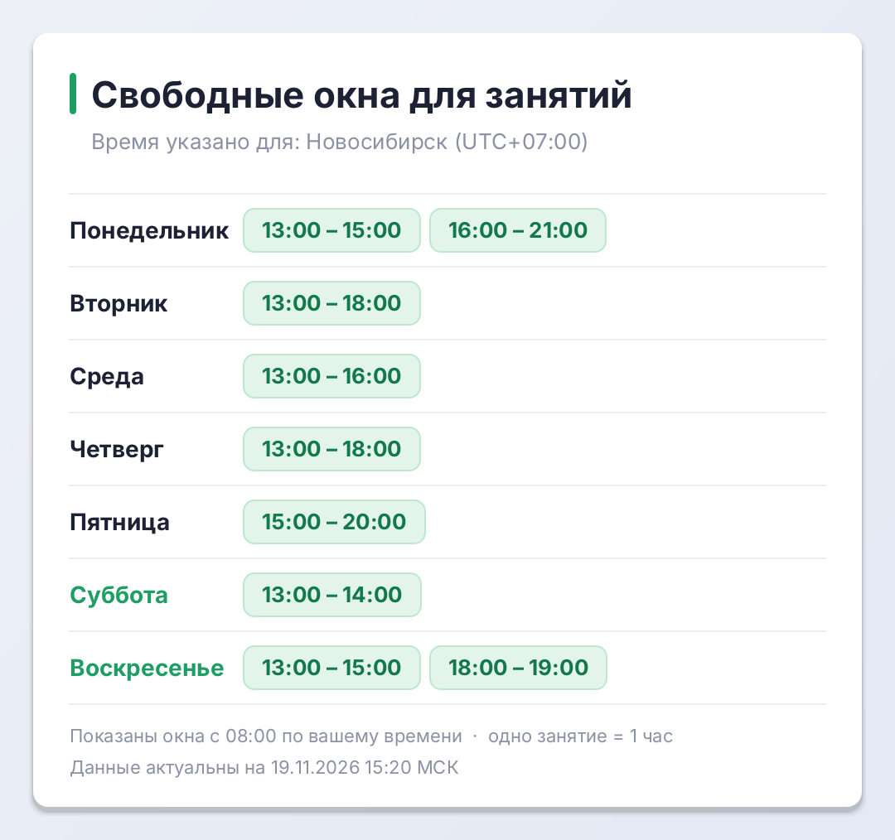

# TutorSlots

Telegram-бот, который читает расписание репетитора из Google-таблицы и отправляет клиенту картинку со свободными часами **в часовом поясе клиента**.

Индивидуальный проект по программной инженерии (4 курс): полный цикл разработки на C++ и Kotlin.



## Как это работает

1. Репетитор ведёт расписание в Google Таблице, как привык: строки — часы по Москве, столбцы — дни недели. Зелёная ячейка — свободно, красная — занято, имя ученика в ячейке — занято, белая пустая — свободно.
2. Бот читает таблицу через Google Sheets API: текст и цвет каждой ячейки.
3. Ядро определяет свободные слоты, переводит их в пояс клиента (с переходом через полночь и через неделю, с поясами вроде UTC+5:30), убирает окна раньше 08:00 по времени клиента и склеивает соседние часы в интервалы.
4. Клиент получает картинку. Пояс выбирается один раз кнопками или вводом города и запоминается.

## Состав репозитория

| Папка | Что внутри | Этап |
|---|---|---|
| [`docs/requirements.md`](docs/requirements.md) | Требования: user stories, функциональные и нефункциональные требования, 25 критериев приёмки | 1 |
| [`docs/architecture.md`](docs/architecture.md), [`docs/uml/`](docs/uml) | Архитектура; диаграммы use case, классов и последовательности (PlantUML) | 2 |
| [`core-cpp/`](core-cpp) | Ядро на C++17: чтение снимка, классификация цвета, сдвиг пояса, интервалы, отчёт. CMake, 37 тестов Google Test | 3 |
| [`app-kotlin/`](app-kotlin) | Порт ядра на Kotlin, клиент Google Sheets, рендер PNG, Telegram-бот. Gradle, 71 тест JUnit 5 | 4 |
| [`docs/comparison.md`](docs/comparison.md) | Сравнение реализаций на C++ и Kotlin | 4 |
| [`docs/test-report.md`](docs/test-report.md) | Отчёт о тестировании и найденных дефектах | 5 |
| [`samples/`](samples) | Обезличенный снимок расписания и эталонные отчёты — общие для обеих реализаций | 3–5 |
| [`.github/workflows/ci.yml`](.github/workflows/ci.yml) | CI: сборка и тесты C++ (Linux и Windows) и Kotlin, побайтное сравнение отчётов | 6 |

## Быстрый старт

**Ядро на C++** (Visual Studio 2022: «Открыть папку» → `core-cpp`):
```powershell
cmake -S core-cpp -B build
cmake --build build --config Debug
build\Debug\tutor_slots.exe samples\snapshot.tsv --offset +07:00
```

**Бот** (Android Studio или IntelliJ IDEA: Open → `app-kotlin`). Подробная настройка ключей описана в [`app-kotlin/README.md`](app-kotlin/README.md).
```powershell
cd app-kotlin
copy bot.env.example bot.env   # вписать токен бота, ключ Google и ссылку на таблицу
.\gradlew.bat run
```

## Демонстрация на защите

[Сценарий доклада на 8 минут](docs/defense.md) содержит команды и порядок показа. Для автономной демонстрации соберите JAR задачей Gradle fatJar и запустите режим render на samples/snapshot.tsv для Москвы и Новосибирска. Обе картинки можно получить без ключей Google Sheets и Telegram. Для защиты пригодятся также [Pull Requests](https://github.com/tusajs/tutorSlots/pulls?q=is%3Apr) и [проверки CI](https://github.com/tusajs/tutorSlots/actions).

## Технологии

C++17 · CMake · Google Test · Kotlin 2.0 · Gradle · JUnit 5 · kotlinx.serialization · Java2D · Google Sheets API v4 · Telegram Bot API · PlantUML · GitHub Actions
